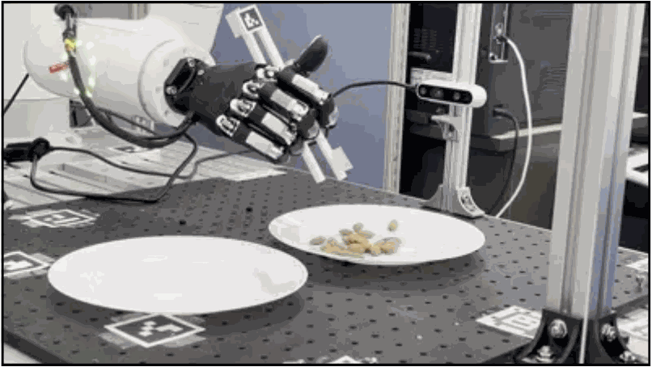
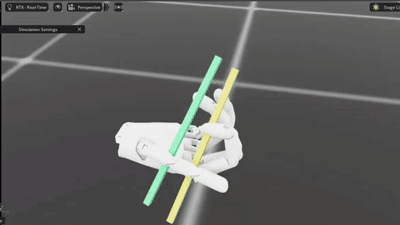
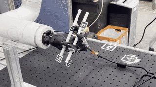
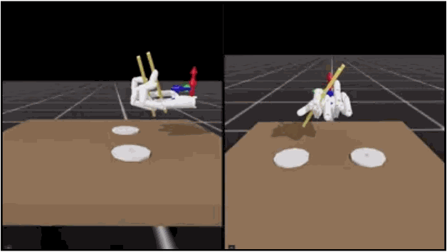
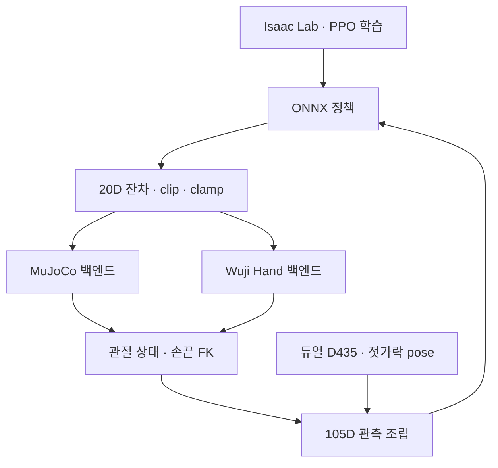

# RL-Based In-hand Manipulation

Indy7·Wuji Hand 플랫폼의 젓가락 조작을 위한 강화학습 프로젝트입니다. Isaac Lab에서 Wuji Hand의 20관절 잔차 정책을 학습하고, 관측·액션 인터페이스를 ONNX·MuJoCo·실물 손 실행기에서 공유하도록 구성했습니다.

**Python · PyTorch · PPO / RSL-RL · Isaac Lab · MuJoCo · ONNX · Intel RealSense D435**

[주요 기능](#주요-기능) · [시스템 구성](#시스템-구성) · [코드 구조](#코드-구조) · [실행 방법](#실행-방법)

## 사진 및 데모



| 시뮬레이션 OPEN/CLOSE | Wuji Hand 실물 적용 시험 |
|---|---|
| [](docs/media/sim-open-close.mp4) | [](docs/media/real-open-close.mp4) |
| [전체 영상 보기](docs/media/sim-open-close.mp4) | [전체 영상 보기](docs/media/real-open-close.mp4) |

GIF는 제공 영상의 짧은 발췌본이며, 각 링크에서 전체 길이의 영상을 확인할 수 있습니다.



**검증 범위:** 시뮬레이션의 파지·자세 정렬·개폐 학습 실험과 실제 손의 개폐 정책 적용 시험입니다. 전체 커리큘럼의 실물 통합 및 Indy7 Arm 추종 제어 결합은 완료하지 않았습니다.


## 주요 기능

- **단계별 태스크**: 기능적 파지 자세 형성, 젓가락 개폐, 물체 집기 등 태스크별 환경·보상 구성
- **잔차 정책**: 현재 관절각에 정책 출력을 관절별 스케일로 더하는 20D 위치 명령
- **실기 관측 구성**: 관절·젓가락 pose 히스토리, 손끝 위치, 직전 액션, OPEN/CLOSE 모드로 105D 입력 조립
- **공통 정책 인터페이스**: 관절 순서·정규화·액션 clip·명령 범위를 학습·추론 코드에서 명시
- **시뮬레이션·배포**: PPO 학습·play, ONNX 추론, MuJoCo·실물 손 백엔드
- **비전·튜닝**: 듀얼 D435의 젓가락 pose 추적, 관절 PD 조정, 정책·관절 명령 기록 도구

## 시스템 구성



배포형 `hand_real`·`hand_final` 정책은 아래 관측 구성을 사용합니다. 태스크·체크포인트가 다른 101D·103D 정책은 별도 어댑터 경로를 사용합니다.

| 입력 | 차원 |
|---|---:|
| 이전·현재 관절 위치 | 40 |
| 현재 손끝 위치 | 15 |
| 젓가락 2개의 이전·현재 pose | 28 |
| 직전 적용 액션 | 20 |
| OPEN/CLOSE 모드 | 2 |
| **합계** | **105** |

출력은 20개 손 관절의 잔차 액션입니다. 정책은 30 Hz, 실물 위치 명령은 90 Hz 기준으로 구성되어 있습니다. 관절별 스케일과 좌표·쿼터니언 규약은 [공통 계약](Deploy/common/policy_contract.py)에서 확인할 수 있습니다.

## 코드 구조

| 경로 | 내용 | 먼저 볼 코드·문서 |
|---|---|---|
| [nrmk_isaaclab_wuji](nrmk_isaaclab_wuji/) | Isaac Lab 확장 패키지·로봇 자산·학습 환경 | [설치 안내](nrmk_isaaclab_wuji/README.md) |
| [hand_grasp 태스크](nrmk_isaaclab_wuji/isaac_neuromeka/tasks/manipulation/hand_grasp/) | 젓가락 파지·자세 형성·개폐·물체 집기 | [태스크 등록](nrmk_isaaclab_wuji/isaac_neuromeka/tasks/manipulation/hand_grasp/__init__.py) |
| [학습·평가 스크립트](nrmk_isaaclab_wuji/scripts/rsl_rl/) | PPO train·play·정책 export | [train.py](nrmk_isaaclab_wuji/scripts/rsl_rl/train.py), [play.py](nrmk_isaaclab_wuji/scripts/rsl_rl/play.py) |
| [Deploy/common](Deploy/common/) | 관절·관측·액션·타이밍 공통 계약 | [policy_contract.py](Deploy/common/policy_contract.py) |
| [Deploy/policy](Deploy/policy/) | 관측 조립·ONNX 추론·액션 변환 | [policy_runner.py](Deploy/policy/policy_runner.py), [action_adapter.py](Deploy/policy/action_adapter.py) |
| [Deploy/backends](Deploy/backends/) | MuJoCo·실물 손 인터페이스 | [소스](Deploy/backends/) |
| [Deploy/vision](Deploy/vision/) | 듀얼 D435·마커 기반 젓가락 추적 | [README](Deploy/vision/README.md) |
| [Deploy/run](Deploy/run/) | 정책 실행·관절 replay | [run_mujoco_policy.py](Deploy/run/run_mujoco_policy.py) |
| [Deploy/models](Deploy/models/) | 배포용 ONNX 모델과 버전 기록 | [모델 목록](Deploy/models/README.md) |
| [pd_auto_tuner](pd_auto_tuner/), [pd_tuner](pd_tuner/) | 관절 PD 자동·수동 조정 | 각 디렉토리 README |
| [examples](examples/) | 장비 없이 실행하는 정책 인터페이스 예제 | [policy_contract_demo.py](examples/policy_contract_demo.py) |

## 실행 방법

### 1. 장비 없이 관측·액션 인터페이스 확인

Python 3.10 이상과 NumPy만 사용합니다. 실제 공통 계약과 액션 어댑터를 불러 관측 차원과 잔차 명령 변환을 확인합니다.

```bash
git clone https://github.com/YunBeeeen/Chopstick_Manipulation.git
cd Chopstick_Manipulation
python3 -m pip install numpy
python3 examples/policy_contract_demo.py
```

`observation_dim: 105`, `action_dim: 20`과 관측 항목별 크기를 출력합니다. 로봇 연결이나 정책 추론 없이 실행합니다.

### 2. Isaac Lab 학습·play

Isaac Sim 5.1·Isaac Lab 2.3 계열 환경에서 [확장 패키지 설치 안내](nrmk_isaaclab_wuji/README.md)에 따라 의존성과 로봇 자산을 준비합니다. 자산이 Git LFS로 관리되는 checkout은 `git lfs pull`도 실행합니다.

```bash
cd nrmk_isaaclab_wuji
python -m pip install -e .
python scripts/rsl_rl/train.py \
  --task hand_real --headless --num_envs 4096 --max_iterations 50000
```

학습한 105D run을 지정해 개폐 정책을 확인합니다. `<RUN>`은 `logs/rsl_rl/hand_real/` 아래에서 확인한 실제 폴더명으로 바꿉니다.

```bash
python scripts/rsl_rl/play.py \
  --task hand_real --num_envs 1 --load_run <RUN>
```

다른 태스크와 checkpoint·환경 인자는 [학습 CLI](CLI.md)를 참고하세요.

### 3. MuJoCo에서 ONNX 정책 실행

저장소 루트에서 실행합니다. `Deploy/assets/`의 로봇 XML·메시와 해당 모델의 관측·액션 규약을 준비합니다.

```bash
python3 -m pip install numpy mujoco onnxruntime
python3 -m Deploy.run.run_mujoco_policy \
  --policy Deploy/models/hand_real_2026-08-18_23-57-25_model4500.onnx \
  --mode close --seconds 3 --viewer --realtime
```

실물 실행은 제조사 SDK, 장치별 관절 한계, 카메라 serial·calibration을 준비하고 [배포 CLI](Deploy/CLI.md)의 read-only 확인 절차부터 사용합니다.

## 관련 문서

- [배포 패키지·105D/20D 인터페이스](Deploy/README.md)
- [학습·배포 세부 계약](Deploy/common/ISAAC_POLICY_CONTRACT.md)
- [모델 버전](Deploy/models/README.md)
- [개발 기록 보관 위치](docs/ARCHIVE.md)
- [기반 확장 패키지의 원본 저작자·출처](nrmk_isaaclab_wuji/README.md#credits)
